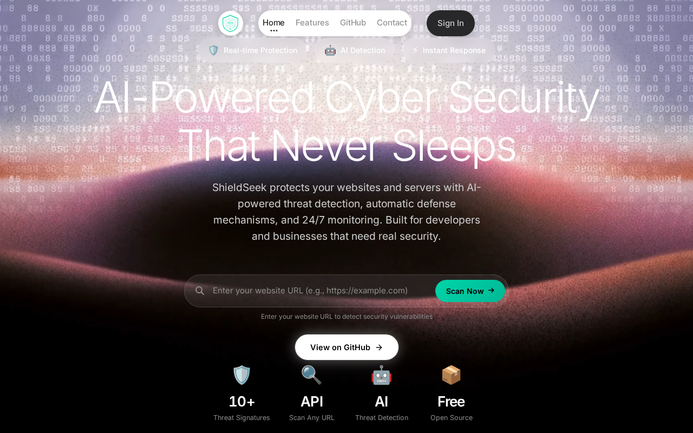

# ShieldSeek 🛡️

**AI-Powered Cyber Security That Never Sleeps**

[](https://github.com/0xshaikh/shieldseek/stargazers)
[](https://opensource.org/license/mit)
[](https://nodejs.org/)
[](https://0xshaikh.github.io/shieldseek/)

## 📸 Screenshots



## 🚀 Overview

ShieldSeek is a super intelligent AI security platform that monitors, detects, and defends against threats 24/7. Built for websites, servers, and applications that need real-time protection.

## ✨ Features

### 🤖 AI-Powered Protection
- 24/7 real-time threat detection
- Automatic defense mechanisms
- Machine learning-based anomaly detection
- Zero-day vulnerability protection

### 🔍 Vulnerability Scanning
- Deep code scanning
- Configuration analysis
- Dependency vulnerability checks
- Security header validation

### 🎯 Threat Detection Engine
- 10+ threat signatures
- SQL Injection detection
- XSS Attempt detection
- Command Injection detection
- Directory Traversal detection
- PHP Wrapper Abuse detection
- Encoded Payload detection

### 🛡️ Security Recommendations
- Content-Security-Policy (CSP) validation
- HTTPS Strict Transportation Security
- X-Frame-Options validation
- XSS Protection header check
- Input sanitization recommendations

## 📦 Tech Stack

- **Frontend**: Vanilla HTML + CSS + JavaScript
- **Backend**: Node.js + Express
- **Security**: Helmet.js + Rate Limiting
- **Testing**: Manual API Testing

## 🚀 Quick Start

### Prerequisites
- Node.js 18+
- npm 9+

### Installation

```bash
# Clone the repository
git clone https://github.com/0xshaikh/nexova-shield.git
cd nexova-shield

# Install backend dependencies
cd backend
npm install

# Start the backend server
npm start

# Open the website
open index.html
```

### Backend API

The backend runs on port 3000 by default:

```bash
# Health check
curl http://localhost:3000/api/health

# Scan a URL
curl -X POST http://localhost:3000/api/scan \
  -H "Content-Type: application/json" \
  -d '{"url": "https://example.com"}'

# Get threat intelligence
curl http://localhost:3000/api/threats/intelligence

# Get protection status
curl http://localhost:3000/api/protection/status

# Create API key
curl -X POST http://localhost:3000/api/keys/create

# List API keys
curl http://localhost:3000/api/keys/list
```

## 📊 API Endpoints

| Method | Endpoint | Description |
|--------|----------|-------------|
| GET | `/api/health` | Health check |
| POST | `/api/scan` | Scan a URL for security issues |
| GET | `/api/threats/intelligence` | Get threat intelligence statistics |
| GET | `/api/protection/status` | Get protection status dashboard |
| POST | `/api/keys/create` | Create a new API key |
| GET | `/api/keys/list` | List all API keys |

## 🧪 Testing

### Test the Backend

```bash
# Test health endpoint
curl http://localhost:3000/api/health
# Expected: {"status":"ok","version":"1.0.0",...}

# Test scan endpoint
curl -X POST http://localhost:3000/api/scan \
  -H "Content-Type: application/json" \
  -d '{"url": "https://example.com"}'
# Expected: Scan results with threats, score, recommendations

# Test invalid URL
curl -X POST http://localhost:3000/api/scan \
  -H "Content-Type: application/json" \
  -d '{"url": "invalid"}'
# Expected: {"error":"Valid URL required"}
```

### Sample Scan Result

```json
{
  "url": "https://example.com",
  "scannedAt": "2026-10-26T11:52:50.801Z",
  "threats": [
    {
      "type": "XSS Attempt",
      "severity": "MEDIUM",
      "pattern": "/<script/i"
    }
  ],
  "score": 85,
  "status": "warning",
  "securityChecks": {
    "hasCSP": false,
    "hasHSTS": false,
    "hasXFrame": false,
    "hasXSSProtection": false,
    "hasCacheControl": false
  },
  "recommendations": [
    "Add Content-Security-Policy header",
    "Enable HTTP Strict Transportation Security",
    "Add X-Frame-Options header",
    "Sanitize all user inputs and outputs"
  ]
}
```

## 🔐 Security Features

- ✅ **Helmet.js** - Security headers
- ✅ **Rate Limiting** - 100 requests/15min per IP
- ✅ **CORS Protection** - Configurable origins
- ✅ **Input Validation** - URL validation
- ✅ **Error Handling** - Graceful error responses

## 📁 Project Structure

```
nexova-shield/
├── index.html              # Main website
├── features.html           # Features page
├── README.md               # This file
├── .gitignore
├── assets/
│   └── logo.svg            # Logo
├── screenshots/
│   └── website.png         # Website screenshot
└── backend/
    ├── server.js           # Express backend server
    ├── package.json        # Dependencies
    └── package-lock.json   # Lock file
```

## 🛡️ Threat Signatures Detected

| Threat Type | Severity | Pattern |
|-------------|----------|---------|
| Code Injection | HIGH | `eval()` |
| Command Injection | HIGH | `exec()`, `system()`, `passthru()`, `shell_exec()` |
| XSS Attempt | MEDIUM | `<script>` |
| SQL Injection | HIGH | `UNION SELECT` |
| Directory Traversal | HIGH | `../`, `//..` |
| Encoded Payload | MEDIUM | `base64_decode` |
| PHP Wrapper Abuse | HIGH | `php://input` |

## 💰 Pricing (Future)

| Plan | Price | Features |
|------|-------|----------|
| **Free** | ₹0/month | Basic scan, 1 site |
| **Pro** | ₹999/month | AI shield, 5 sites, 24/7 monitoring |
| **Business** | ₹4,999/month | Full protection, bounty team |
| **Enterprise** | ₹19,999/month | Dedicated team, custom solutions |

## 🔗 Links

- **Website**: https://0xshaikh.github.io/nexova-shield/
- **Features**: https://0xshaikh.github.io/nexova-shield/features.html
- **GitHub**: https://github.com/0xshaikh/nexova-shield
- **Backend API**: http://localhost:3000/api

## 📄 License

MIT License - See [LICENSE](LICENSE) file for details.

## 🤝 Contributing

Contributions are welcome! Please:
1. Fork the repository
2. Create a feature branch
3. Commit your changes
4. Push to the branch
5. Create a Pull Request

## 📧 Contact

- **GitHub**: https://github.com/0xshaikh
- **Email**: support@nexova.shield (future)

---

**Built with ❤️ by 0xshaikh**
